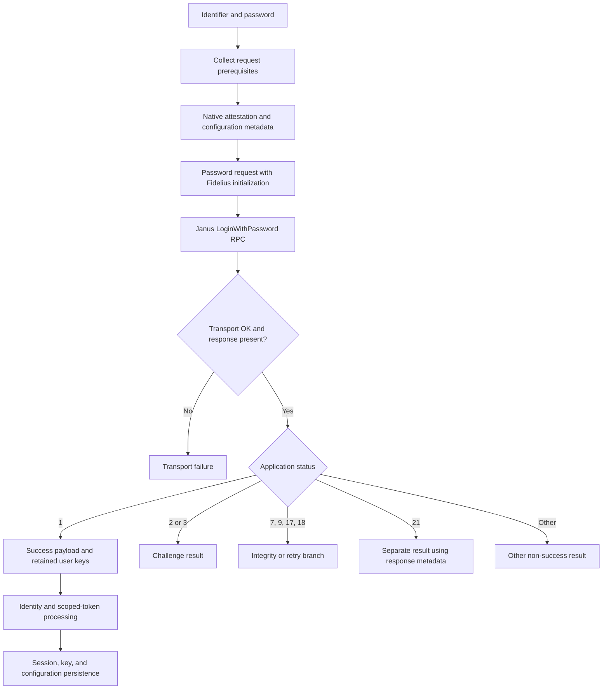

# Snapchat Password Login and Session Flow

Investigation date: 2026-10-22. This is a REA evidence-backed explanation of
the installed Android **14.29.0.50** build, not a working login specification.
The bridge is **not ready for real account testing**.

## Scope and Evidence

The inspected base APK has SHA256
`e4d9d4aed7f7b354e8123e0e0ccdd344a6b2e0d023a36e12f31f9cc427ff33d7`.
The supplied 14.30.0.39 Beta is a different artifact; its class names and native
addresses must not be substituted into this flow.

REA 6.7.0 uses JADX headless 0.7.1 and JDK 21 for the static observations below.
Complete JSON records are retained locally under
`%LOCALAPPDATA%\REA\device-snapchat-20261022-154124`. Their
`.normalized_result.source.text` contains decompiled method text; `subject.digest`
binds each record to its APK. Decompiled names and control flow are analysis
results, not original source or proof of live server behavior.

Evidence labels used throughout:

- **Static observation:** a declaration, serializer, call site, or branch read
  through REA/JADX.
- **Prior runtime observation:** an already retained local probe or empty RPC;
  no new runtime probe or account request is part of this documentation pass.
- **Unknown:** behavior not established by those observations. In particular,
  required server policy cannot be inferred merely from an optional client field.

## Flow Overview



The diagram summarizes recovered client branches. It does not imply that the
bridge implements the challenge continuations or that any session was accepted.

## Password Request

**Static observation:** `xq60.q` prepares prerequisites through `xu60.a` and
configuration metadata through `xu60.f`. A builder branch in `s460.apply`
assembles `n070`; `mq60.subscribe` serializes it and invokes:

```text
aws.api.snapchat.com:443
/snapchat.janus.api.LoginService/LoginWithPassword
```

The `n070.writeTo` serializer establishes these field numbers:

| Field | Recovered meaning |
| --- | --- |
| 1 / 2 / 3 | Username / email / phone identifier oneof |
| 4 | Password |
| 5 | Attempt metadata |
| 7 | `v0u` Fidelius initialization payload |
| 8 | `c3e` client configuration metadata |
| 9 | Password-source value |
| 10 | Phone-context alternative in the identifier oneof |
| 11 | WhatsApp-related boolean |
| 15 | `fs60` request prerequisites |

**Live-capture validation (14.29.0.50, NoEmulator VM):** a Frida hook on
`UnifiedGrpcService.unaryCall` captured the full `LoginWithPassword` request
(5987 bytes). Feeding the captured field values back through
`PasswordRequest.Marshal` reproduced the request **byte-for-byte** (5987/5987),
so the Go n070 encoder is byte-identical to the APK's. The live request also
confirmed the transport: the request reaches
`/snapchat.janus.api.LoginService/LoginWithPassword` as a gRPC unary call whose
body is a `java.nio.ByteBuffer`.

Remaining divergence from the real app is entirely in runtime *inputs*, not the
wire encoding:

- `c3e` field 2 (`etag`): the VM app sends its synced COF etag; a fresh bridge
  client legitimately sends empty.
- `fs60` field 7 (`wgg0`): the VM app sends 104 COF capability gate IDs. The
  bridge sends none; the nil-flag request still reaches the server's
  account-level check, so the list appears optional.
- `fs60` fields 1-6 and `v0u` field 2: per-request UUIDs and the Fidelius seed,
  regenerated on every attempt.
- `n070` field 9 (`PasswordSource`): **1** for a manually typed password. The
  earlier static recovery of 256 (`const/16 v24, 0x100`) was superseded by the
  capture; the Go harness now sends 1.

Field 8 is not an additional password or device credential: `mr60.toString`
labels its inputs `LoginConfigs(cofSyncMetadata, cofRoutingTag)`, while
`b3e.toString` labels the sync metadata `etag` and `bitmap`. The setters in
`xq60.a` map that wrapper into `c3e`; the Go `COFMetadata` encoder reproduces
this layout (fields 1/2/3/4, version fixed at 385) and was confirmed
byte-identical by the live-capture roundtrip.

### Transport Metadata

**Static observation:** `yku0.invoke`, selector 3, constructs the Android user
agent from the app version and Android build fields in this form, with an
optional build-variant suffix:

```text
Snapchat/<version> (<model>; Android <release>#<incremental>#<sdk>; gzip)
```

The header mapper also supplies language and request-created-at metadata, with
optional routing and pre-auth token headers. These headers are separate from
the protobuf prerequisites and Fidelius initialization message.

**Prior runtime observation:** an empty request with a generic bridge user
agent returned gRPC `InvalidArgument` / `user agent is required`. An empty
request using the recovered format and synthetic device fields returned
`InvalidArgument` / `invalidRequest`. That transition establishes only that
the request reached a different validation stage, not that the profile,
prerequisites, account, or session would be accepted.

## Private Device Attestation

**Static observation:** `xu60.a` combines configuration state, native login
attestation, and a conditional SafetyNet operation. The observed SafetyNet
operation depends on an input byte array; that condition does not establish
whether a server will require an integrity result for a particular account.

The installed-build call chain is:

```text
xu60.a -> qb00.call selector 26 -> x5o0.c(path) -> x5o0.b(...)
    -> original afx request serialization -> native provider
```

The installed JNI owner is `yblj.prh`; `a([B)[B` is the native byte-array
boundary. The loader is `a6o0.a`. The full wrapper also includes metadata from
`ig3`, which was absent from the minimal isolated probe.

`fs60.writeTo` places the native output in **prerequisite field 11**; that
prerequisite message is **password-request field 15**. This is distinct from
channel/call options: the login channel's `requiresAttestation=false` and the
call's `requireAuth=false` do not remove the attestation inside the request.
They also do not establish any way to bypass server validation.

**Prior runtime observation:** an isolated shell-owned Android process loaded
the original native library, serialized a 54-byte minimal input, and obtained
4,515 output bytes. This did not execute as Snapchat's application UID, did not
exercise the full wrapper, and did not establish server acceptance. Output and
device-specific values remain local; no account credentials or native output
were submitted to Snapchat during that probe.

**Unknown:** full input semantics, native output structure, device/account
binding, freshness requirements, and which combinations the server accepts.
The report describes the boundary; it does not reproduce or forge attestations.

## Fidelius Initialization

**Static observation:** `a3u.toString` names its two members
`FideliusInitPayloadAndKeys(fideliusInitPayload, userKeys)`. Member `a` is the
wire message `v0u`; member `b` is the local `r241` user-key context. These are
not interchangeable: the application sends the initialization message and keeps
the user-key context for later success processing.

`vo3.apply`, selector 28, packages that pair:

- `v0u` field 1 receives repeated decoded byte arrays from `n1u.h()`.
- `v0u` field 2 receives a `k5u` message derived from `r241`.
- `v0u` field 3 receives bytes from `n1u.e()`.
- The return value retains the same `r241` alongside the wire message.

The nested `k5u` fields are established structurally, not semantically:

| Field | Value assigned by the builder |
| --- | --- |
| 1 | `mor0.d(r241.f())` |
| 2 | `r241.c()` |
| 3 | `r241.e()` |
| 4 | `r241.i()` |

`r241.f()` returns stored byte-array member `c`. `mor0.d` delegates to
`uh3.w1(26, 91, bytes)`. A new REA inspection resolves that helper to
`Arrays.copyOfRange(bytes, 26, 91)` after a length check: the end-exclusive
range produces 65 bytes. This establishes the transform, not a curve,
signature scheme, or private/public key encoding.

**New REA check:** `p241.b(byte[])` is a parser, not a generator. It rejects
empty input, parses existing bytes with `q700.g`, constructs `r241` from that
parsed object's accessors, and returns null on its parse exception. Treating
this helper as a fresh-key factory would be a reconstruction error.

The inspected `oz4.call` selector 0 is also not fresh-key generation: it uses
success payload `m2u` and the retained `r241` to construct key material for
subsequent storage. The generation algorithms and the roles of each byte array
remain unresolved. Do not substitute guessed generic key pairs.

## Challenges and Retries

**Static observation:** the response is a transport result plus `o070`.
`lq60.a` delivers that pair. `nfl.apply`, selector 18, first rejects a non-OK
gRPC status or missing response, then dispatches on application status.

| Application status | Recovered client behavior |
| --- | --- |
| 1 | Extract success oneof `h18`, then call `rz4.c` with retained user keys |
| 2 | Read oneof field 3 (`ik21`) and construct `x05`, a non-session result |
| 3 | Read oneof field 4 (`jpe0`) and construct `t05`, a non-session result |
| 7 / 9 / 17 / 18 | Re-enter `xq60.q` with status-selected context and `sh2.b` |
| 21 | Construct `p05` with `c15(I)`, the retained `a3u`, and oneof field 13 (`gu2`) |
| Other | Do not take the status-1 success path |

The retry-related branches retain the Fidelius pair and configuration context;
they do not discard everything and begin a proven fresh-key login. `sh2.b` is
passed back to the request path, but its semantic meaning is not established
here. No global retry limit has been verified by inspecting this handler alone.

This is not a complete status-enum dictionary. The inspected branches do not
justify naming every challenge SMS, TOTP, CAPTCHA, or account lock. Continuation
RPCs, user interaction, attempt limits, retry bounds, and server enforcement are
not fully traced. A retry must not be interpreted as a successful login, and a
challenge result must not be persisted as a normal session.

## Accepted-Session Processing

**Static observation:** `o070.writeTo` writes application status as field 1;
its success oneof alternative is field 2 (`h18`). A successful transport alone
does not select that application success path.

The status-1 handler calls `rz4.c(h18, ..., a3u.b)`. Thus success processing has
both the server payload and the local Fidelius user-key context. Following
`rz4.c`, `bz4.apply`, and `iz4.run` exposes separate identity, persistent-token,
cache-only-token, key, and configuration processing, not a single token string
that can safely be copied into the legacy session model.

The recovered token nesting is:

```text
o070 field 2 -> h18
h18 field 1 -> b841
b841 field 6 -> ffu0
ffu0 field 2 -> repeated ivs0 scoped-token messages
```

`ivs0` serializes token string `b` as field 1, scope string `c` as field 2, and
long-valued scalar `t` as field 3. `weo.d` passes these into the
`ip9.call` selector-6 conversion. That conversion resolves scopes using
`liu0.a`, combines a current clock with server timing values, and constructs
stored token objects. It also has separate multi-scope handling.

For a token with its timing field present, the mechanical assignments are
equivalent to this pseudocode; member names intentionally remain neutral:

```text
nowValue = bn2.J(clock, 1000)
baseA = timing.b if present, otherwise 0
baseB = timing.c if present, otherwise 0
remaining = networkToken.t - baseA
candidate = networkToken.t + nowValue - baseB
stored.I = nowValue + remaining
stored.X = candidate if candidate > nowValue
           otherwise int64(0.8 * remaining + nowValue)
```

**Unknown:** the exact timing units and all clock-offset rules, identity-string
semantics, complete session validity conditions, refresh behavior, and all
cryptographic processing. Passing key context onward does not prove any specific
decryption algorithm, nor does the absence of one in a single method prove
that no decryption is needed.

The observed persistence pipeline is a sequence of asynchronous side effects;
its presence does not establish atomic commits, rollback, or complete failure
cleanup. Those contracts need their own investigation and bridge tests.

The [Go envelope parser](../../janus.go) deliberately stops before this work.
Its status-1/payload checks are not accepted-session extraction or persistence.
No real server-accepted session was captured or decoded in this investigation.

## REA Work Log

This pass uses the existing REA CLI, not a substitute decompiler or an assertion
that an MCP connection exists. The following PowerShell shows the actual route:

```powershell
$reaHome = Join-Path $env:LOCALAPPDATA 'REA'
$node = Join-Path $reaHome 'node-v24.17.0-win-x64\node.exe'
$cli = Join-Path $reaHome 'runtime\node_modules\rea-agents\scripts\rea.mjs'
$artifacts = Join-Path $reaHome 'device-snapchat-20261022-154124'
$apk = Join-Path $artifacts 'base.apk'

& $node $cli inspect-android-method $apk defpackage.p241 b --format json |
    Tee-Object -FilePath (Join-Path $artifacts 'login-flow-p241-key-construction.json')
& $node $cli inspect-android-class $apk defpackage.uh3 --format json |
    Tee-Object -FilePath (Join-Path $artifacts 'login-flow-key-transform-inventory.json')
& $node $cli inspect-android-method $apk defpackage.uh3 w1 --overload-index 0 --format json |
  Tee-Object -FilePath (Join-Path $artifacts 'login-flow-key-byte-range.json')
```

Use new output names when reproducing these commands. A fresh REA invocation
can produce a different Evidence ID; keep the original records and their
artifact hashes rather than silently replacing the evidence behind a claim.

Key retained records and Evidence IDs:

| Observation | Local JSON record | Evidence ID |
| --- | --- | --- |
| Fidelius pair assembly | `password-fidelius-init-creation.json` | `ev_34a74cf66b37bb2416703825bbfc7f43aff0b43958d193f15df4022248cc8a6a` |
| Existing-key parser | `login-flow-p241-key-construction.json` | `ev_4c8e4265329b1151a8d8b506e2a08293c16aba9efbf338fcffefb4021ad4821f` |
| Exact byte-transform signature | `login-flow-key-transform-inventory.json` | `ev_312ef614fc8e3e8b6e81f3cfea723ef84c4179858b74af39b04a14759d1bd1fd` |
| End-exclusive byte-range transform | `login-flow-key-byte-range.json` | `ev_e62c208c25c7699d2bc0342dff2411d20e444b4befeab2c99c31b41b0168a518` |
| Response dispatch and retry call | `password-response-status-transform.json` | `ev_00678dc6ef75381e4998d5fef89da5308a1a3974292cea6b01e477986649e55b` |
| Full native-provider wrapper | `attestation-request-serializer.json` | `ev_ac3f1014ac5fdedb762bd47234324c89c4e66ace88ac5ef61d82c60ff66f8e4a` |
| COF wrapper labels | `password-client-metadata-labels.json` | `ev_e078f59d65d77f52565be331b0d23610df817a4f2c0ebb57f25c135f6c932c26` |
| ETag and bitmap labels | `password-client-device-metadata-labels.json` | `ev_19e8a2c6b4dcdfdb8f07f04dadfb9925b7ec1b18c33e86b948b72fc709925476` |
| Android user-agent formatter | `janus-user-agent-formatter.json` | `ev_461f91b42d8cd4c26c361a3cff7b026533545f116149787c956d1341e13e7137` |
| Channel option names | `janus-grpc-parameters-constructor.json` | `ev_eb3539bbeb9fec4830a44a65f64ba27870f2a790acff76dd59e14c13e854d12b` |
| Per-call option names | `janus-native-call-options-constructor.json` | `ev_974d9ec0c568ff735952291a8b2cbba7bad113cde599d516b8cd2bafe6a4194b` |
| Response envelope serializer | `response-success-o070-writeTo-ccce4901d79f4ac781d328a40e728617.json` | `ev_8b91d068392630ba76b1dde7d7195ef8c9df68d0efea940bb90667f4f9fadf74` |
| Success-processing entry | `response-success-rz4-c-5445116c6d9c4d9c80f4e0a26e0f806e.json` | `ev_0ff47561bab6823dd60430f1ea1091b5cdf8b1ceef322f5e41300449e5260c4b` |
| Success payload serializer | `response-success-h18-writeTo-4cdbbc140f144f18ad1ccc8027ffaf70.json` | `ev_ff44eba09c2a50cb73d136cd5c5ac72e616c08b62a8255f0a268db6c7f2ac92e` |
| Identity message serializer | `session-identity-wire-fields.json` | `ev_735dfa78e68e33ec6b4d0a7fa031cbbb29f1b8300cfae18735ff3bc62f50a27e` |
| Token container serializer | `session-token-wire-fields.json` | `ev_182b3167b4e1c604a5a8464cb0a15839cfb4aaa67135aa2e3a4d183377acdf0c` |
| Scoped-token serializer | `scoped-token-wire-fields.json` | `ev_5243d32873363120f8c5ea89aa9ebdf0e6838fd1babe0c6a99a3d1245acf5ff5` |
| Token-to-storage conversion | `scoped-token-conversion-callable.json` | `ev_fb7cccb454e5379402f0bdcbd945a27846d7caf3052d090f520b7ef8e7e590b3` |

See [APK findings](FINDINGS.md) for request/prerequisite Evidence IDs and prior
runtime limitations, and [the progress summary](../../SUMMARY.md) for the
implementation backlog. The evidence is local, so these IDs are provenance
references, not public download links. Native blobs, account data, private keys,
and device identifiers must remain out of the repository.